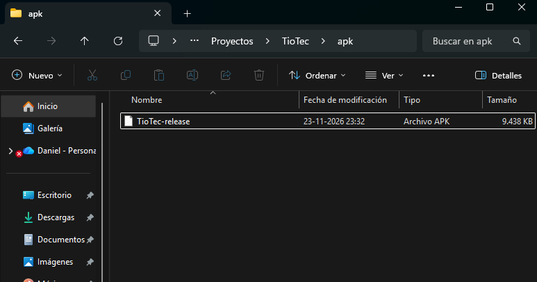
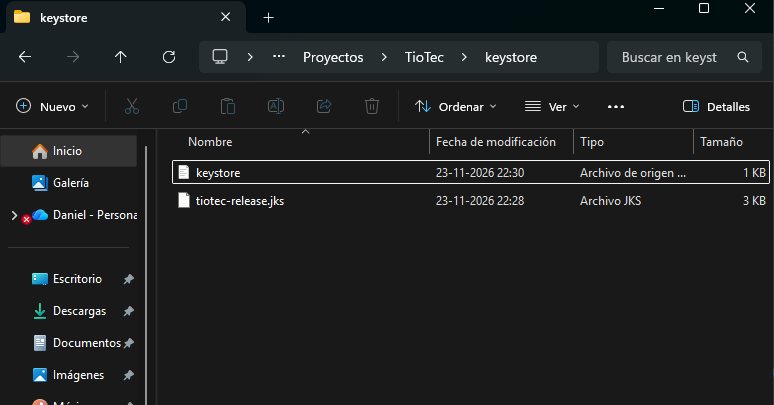

# TíoTec Preventivo

App Android desarrollada para el caso semestral TíoTec Preventivo (MCmovil SpA) del ramo
DSY1105 Desarrollo de Aplicaciones Móviles, Duoc UC sede Alameda.

La idea de la app es que una persona sin conocimientos técnicos pueda revisar sus hábitos
de seguridad digital (respaldos, actualizaciones, contraseñas y recuperación de cuentas),
ver qué le falta mejorar y llevar un checklist de las acciones que tiene pendientes.

Para la Evaluación Parcial 4 se agregaron dos microservicios propios en Spring Boot,
el consumo de una API externa, pruebas unitarias y el APK firmado.

## Integrantes

- Cristopher Moreno
- Daniel Soto

## Tecnologías usadas

**App móvil**
- Kotlin y Jetpack Compose con Material 3
- MVVM (ViewModel, StateFlow y Repository)
- Navigation Compose
- Retrofit + Gson para consumir la API externa y los microservicios
- Room para guardar datos en el teléfono (evaluaciones, checklist y perfil)
- WorkManager para los recordatorios
- Coil para mostrar la foto de perfil
- Kotest, MockK y kotlinx-coroutines-test para las pruebas unitarias

**Microservicios**
- Java 21 y Spring Boot 4.2 (Spring Web MVC, Spring Data JPA, Validation)
- Base de datos H2 guardada en archivo, con consola web
- Maven

## Funcionalidades

- Evaluación de 8 preguntas que entrega un puntaje y recomendaciones.
- Checklist priorizado (Alta, Media, Baja) con las acciones pendientes según las respuestas.
- Historial de evaluaciones guardado en Room.
- Perfil ficticio con foto tomada con la cámara o elegida desde la galería.
- **Dispositivos de prueba** del perfil guardados en el microservicio `ms-dispositivos`.
- **Solicitudes de asistencia** guardadas en el microservicio `ms-solicitudes`: se crean,
  se listan, se avanza su estado (Pendiente → En revisión → Resuelta) y se eliminan.
- **Soporte de Android**: consulta en la API externa endoflife.date qué versiones de Android
  siguen recibiendo parches de seguridad.
- Recordatorios con notificaciones.
- Consejos de seguridad que se cargan desde un archivo JSON en GitHub.
- Formularios de registro, perfil, dispositivos y solicitudes con validaciones.
- Animaciones en el checklist y en la foto de perfil.

Todos los datos de la app son ficticios.

## Endpoints utilizados

### Microservicio `ms-solicitudes` (puerto 8081)

| Método | Endpoint | Uso en la app |
|---|---|---|
| GET | `/api/solicitudes` | Lista las solicitudes (de la más nueva a la más antigua) |
| GET | `/api/solicitudes/{id}` | Obtiene una solicitud |
| POST | `/api/solicitudes` | Crea una solicitud (queda en estado "Pendiente") |
| PUT | `/api/solicitudes/{id}` | Actualiza una solicitud (botón "Avanzar estado") |
| DELETE | `/api/solicitudes/{id}` | Elimina una solicitud |

### Microservicio `ms-dispositivos` (puerto 8082)

| Método | Endpoint | Uso en la app |
|---|---|---|
| GET | `/api/dispositivos` | Lista los dispositivos de prueba |
| GET | `/api/dispositivos/{id}` | Obtiene un dispositivo |
| POST | `/api/dispositivos` | Registra un dispositivo |
| PUT | `/api/dispositivos/{id}` | Actualiza nombre y sistema |
| DELETE | `/api/dispositivos/{id}` | Elimina un dispositivo |

Desde el emulador la app llama a los microservicios con la dirección `http://10.0.2.2:PUERTO/`,
que es el computador visto desde el emulador.

### API externa

| Método | Endpoint | Uso en la app |
|---|---|---|
| GET | `https://endoflife.date/api/android.json` | Versiones de Android y fecha de fin de soporte (pantalla "Soporte de Android") |

También se consumen `https://raw.githubusercontent.com/kcique91/TioTec/master/consejos.json`
(consejos) y `https://jsonplaceholder.typicode.com/posts` (ejercicio de la Guía 14).

## Estructura

```
TioTec/
├── app/                         app móvil (Gradle)
│   └── src/
│       ├── main/java/duoc/appmoviles/
│       │   ├── components/      componentes reutilizables
│       │   ├── data/            Room (entidades, DAOs, base de datos)
│       │   ├── model/           clases de datos
│       │   ├── navigation/      rutas de la app
│       │   ├── network/         Retrofit (API externa y microservicios)
│       │   ├── notifications/   recordatorios
│       │   ├── repository/      repositorios: el ViewModel les pide los datos
│       │   ├── screens/         pantallas
│       │   ├── ui/theme/        colores y tema
│       │   └── viewmodels/      lógica y estado de cada pantalla
│       └── test/                pruebas unitarias (Kotest + MockK)
├── backend/
│   ├── ms-solicitudes/          microservicio Spring Boot (Maven)
│   └── ms-dispositivos/         microservicio Spring Boot (Maven)
├── apk/TioTec-release.apk       APK firmado
└── keystore/                    llave de firma (.jks) y su configuración
```

Cada microservicio está separado en `model` (entidad JPA), `repository` (JpaRepository),
`service` (lógica de negocio) y `controller` (endpoints REST).

## Pasos para ejecutar

### 1. Microservicios
1. En Android Studio o IntelliJ: **File → Open** → `backend/ms-solicitudes/pom.xml` → **Open as Project**.
2. Esperar que Maven descargue las dependencias y ejecutar `MsSolicitudesApplication`.
   La consola debe decir `Tomcat started on port 8081`.
3. Repetir con `backend/ms-dispositivos/pom.xml` y `MsDispositivosApplication` (puerto 8082).
4. Para revisar: `http://localhost:8081/api/solicitudes` y `http://localhost:8082/api/dispositivos`.
   La base de datos se puede ver en `http://localhost:8081/h2-console`
   (JDBC URL `jdbc:h2:file:./data/solicitudesdb`, usuario `sa`, sin clave).

### 2. App móvil
1. Abrir la carpeta `TioTec` en Android Studio y esperar el Gradle Sync.
2. Crear un emulador desde Device Manager.
3. Con los dos microservicios encendidos, darle a Run.

> Nota: la app usa `targetSdk 36`. En Android 17 (API 37) las apps nuevas necesitan un permiso
> especial para conectarse a la red local, y la conexión a `10.0.2.2` quedaba bloqueada.

### 3. Pruebas unitarias
En la Terminal de Android Studio:
```
.\gradlew testDebugUnitTest
```
o clic derecho en `app/src/test/java` → **Run 'Tests in java'**.
Se prueban los ViewModel y los repositorios; las respuestas de los microservicios y de la API
externa se simulan con MockK, por lo que no necesitan estar encendidos.

## APK firmado

El APK firmado está en `apk/TioTec-release.apk` y la llave en `keystore/tiotec-release.jks`
(alias `tiotec`). La firma está configurada en `app/build.gradle.kts` (`signingConfigs`) y lee
los datos de `keystore/keystore.properties`.

Pasos que se siguieron:
1. **Build → Generate Signed App Bundle or APK → APK**.
2. **Create new…** para crear la llave `.jks` (contraseña, alias, validez de 25 años y datos del certificado).
3. Elegir la variante **release** y crear.
4. Se agregó `signingConfigs` en `build.gradle.kts` para poder generarlo también con
   `.\gradlew assembleRelease`.

En un proyecto real la llave y sus contraseñas no se suben al repositorio; aquí se incluyen
porque la evaluación pide entregarlas.




## Planificación

Tablero de Trello: https://trello.com/b/rR3gBaMs/tiotec
